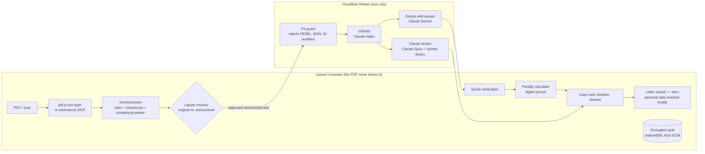

# DORA: developer-delay claims analysis for law firms

[](https://github.com/mTylewski/dora/actions/workflows/ci.yml)


**DORA** (*Deweloperskie Opóźnienia: Roszczenia i Analiza*) helps Polish law firms handle a common type of case: an apartment buyer claiming contractual penalties from a developer who handed over the flat or signed the transfer deed late.

A lawyer uploads the case documents: the development agreement, annexes, the handover protocol and the transfer deed. These are often scanned PDFs. A few minutes later DORA returns:

1. **A case card.** It lists the deadlines, price, penalty rate and cap, liability exclusions and actual dates. **Every value comes with a verbatim quote and a page number**, and the code checks that each quote really appears in the document.
2. **A penalty calculation and timeline.** Deterministic code with tests computes these, not the LLM, and the UI shows the full calculation path.
3. **Flags for potentially abusive clauses.** Each flag has the quote and a short reasoning, matched against a clause-pattern library.
4. **A draft demand letter** (.docx) built from the firm's own Word template.

Reading a 25-page notarial agreement and preparing a demand letter takes a lawyer hours. With DORA, the lawyer reviews and confirms a prepared draft instead. The system never gives legal advice: the lawyer decides and signs.

> **Live demo:** available on request. The hosted version uses invitation links with a usage limit.
> Ask via my GitHub profile: [github.com/mTylewski](https://github.com/mTylewski)

---

## How it works



There are two deployment modes sharing the same prompts, schemas and rules:

| | Hosted pilot (`demo/`) | Production MVP (`app/`, `pipeline/`) |
|---|---|---|
| Runs on | the lawyer's browser + a Cloudflare Worker | the law firm's own EU server |
| OCR and anonymization | in the browser (TypeScript) | on the server (Python) |
| Storage | encrypted on the lawyer's computer | PostgreSQL on an encrypted volume |
| Stack | TypeScript, Vite, Workers, KV | Python 3.12, FastAPI, RQ, Docker, Ansible, nftables |

## AI engineering highlights

- **Grounded extraction instead of trust.** Every extracted field must carry a verbatim quote and a page number. Code normalizes whitespace and checks that the quote occurs in the source text. A quote that cannot be found turns the field into `needs_review`. A value missing from the documents must be `null`; the prompt forbids guessing, and the schema allows `null`.
- **The model never does arithmetic.** Days of delay, penalty amounts, caps and statutory interest come from a deterministic calculator: money held as integer grosze, 100% test coverage, hand-computed examples in the tests. Calculation rules are configuration, not code.
- **Structured outputs + validation + one retry.** Responses are constrained by a JSON schema (Claude structured outputs). They are then validated with Pydantic (Python) or zod (TypeScript). One retry carries the validation errors; after that, a clean error goes to the UI. The full Pydantic schema was too large for the grammar compiler, so the model gets a compact schema generated from the same source.
- **Model routing by task:**

  | Step | Model |
  |---|---|
  | Document classification | Claude Haiku 4.5 |
  | Extraction with quotes | Claude Sonnet 5.5 |
  | Clause review | Claude Opus 5.5, with the clause library in a cached system prompt |

  Extraction and clause review run in parallel. A typical case costs about $0.30–0.50 and takes about 2 minutes, including OCR.
- **Fixed pipeline, no agent.** The model has no tools and no network access. Every step is a fixed call with a fixed schema, which is easier to test, audit and explain to a lawyer.
- **Privacy by design.**
  - Personal data is replaced with tokens (`[OSOBA_1]`, `[PESEL_1]`) *before* any API call. Identifiers are matched by rules and checksums: PESEL, NIP, REGON, ID card, land register number, IBAN, phone, e-mail. A komparycja parser for Polish notarial deeds finds names, roles and addresses.
  - The lawyer sees the original and the anonymized text side by side and must approve. Leftover capitalized words in the komparycja are highlighted for review.
  - The Worker re-runs the identifier rules and rejects text that still contains personal identifiers (HTTP 422).
  - The token mapping never leaves the browser. Personal data is restored only locally, when the letter is generated.
- **Evals and regression gates.**
  - An anonymization gate of 26 synthetic cases, including variants collected from public notarial templates: double-barrelled surnames, names in capitals, particles, maiden names, spouses, OCR-broken e-mails. The bar is zero leaks.
  - An evaluation harness for extraction accuracy per field, with release thresholds (`evals/`). The labelled contract set is still being collected.
  - The TypeScript port must reproduce the Python output **exactly**: 32 parity cases for anonymization, plus parity tests for the letter values.
- **Cost control for the hosted demo.**
  - Invitation links carry a random token, and the Worker stores only its SHA-256 hash in KV.
  - Each invitation has a per-invitation analysis limit and an expiry date.
  - Failed analyses are refunded automatically.
  - An admin CLI covers create, list, top-up, extend and revoke.
- **No secrets in code.** The API key exists only as a Worker secret or server environment variable. CI scans the repository for credentials.

## Quality

- **238 automated tests:** 149 Python + 89 TypeScript. They cover the calculator, quote verification, anonymization, schemas, the Worker (CORS, PII guard, limits, invitations), the encrypted vault, .docx template filling and UI smoke tests.
- CI runs on every push (badge above): Python tests with coverage, TypeScript type checks and tests, and the secret scan.

## Repository layout

| Path | What is inside |
|---|---|
| `pipeline/` | Python pipeline: PDF text, OCR, anonymization, classification, extraction, quote verification, clauses, letter |
| `calculator/` | deterministic penalty calculator (Python, `Decimal`, 100% coverage) |
| `app/`, `web/` | FastAPI app for the production MVP: 2FA login, cases, review, corrections, access log |
| `demo/` | hosted pilot: browser app (`web/`), Cloudflare Worker (`worker/`), shared TypeScript ports (`shared/`) |
| `prompts/`, `schemas/`, `config/`, `clauses/` | prompts, JSON schemas, model and calculator settings, clause-pattern library |
| `evals/` | evaluation sets, scoring, anonymization gate |
| `deploy/` | Docker Compose, Ansible, nftables egress firewall, signed image updates |
| `docs/` | documentation for law firms (in Polish): data flow, user guide, installation |
| `CLAUDE.md` | the engineering brief this project was built from with Claude Code: non-negotiable rules, pipeline, schema, quality gates |

## Running locally

```bash
# Python pipeline and calculator
python -m venv .venv && source .venv/bin/activate   # Windows: .venv\Scripts\activate
pip install -e ".[dev,ocr]"
pytest --cov

# Browser app + Worker (needs your own Anthropic API key in demo/.dev.vars)
cd demo
npm ci
npm test
printf 'ANTHROPIC_API_KEY=sk-ant-...\nINVITES_REQUIRED=false\n' > .dev.vars
npm run dev:worker   # http://localhost:8787
npm run dev:web      # http://localhost:5173
```

More detail: [demo/README.md](demo/README.md) (hosted pilot, invitations) and [docs/README.pl.md](docs/README.pl.md) (production MVP, in Polish).

## Status and known limitations

- This is a pilot. The clause-pattern library and its legal sources are marked `verified: false` until a lawyer confirms them. The day-count convention is a configuration option to be confirmed per firm.
- Anonymization is rule-based and covers the patterns seen so far. The lawyer's approval screen is the final safeguard, and every new miss becomes a test case.
- OCR handles printed scans well. Handwritten handover protocols may need dates entered manually.

## Author

**Michał Tylewski**, AI Engineer. Built with Claude Code; [CLAUDE.md](CLAUDE.md) shows how the work was specified and constrained.

All rights reserved; the code is published for viewing and evaluation only. See [LICENSE](LICENSE).
