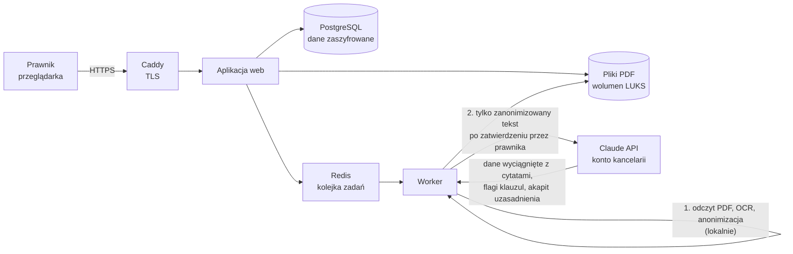

# Przepływ danych

Dokument opisuje, gdzie trafiają dane sprawy w wersji wdrażanej na serwerze kancelarii (Etap B).

## Schemat

Wszystkie elementy poza Claude API działają na serwerze kancelarii, na jej koncie u dostawcy VPS w UE.

## Co wychodzi poza serwer

| Dane | Gdzie | Kiedy |
|---|---|---|
| Tekst dokumentów po anonimizacji (znaczniki zamiast danych osobowych, np. `[OSOBA_1]`, `[PESEL_1]`) | Claude API, konto kancelarii | po zatwierdzeniu anonimizacji przez prawnika |
| Fakty do uzasadnienia pisma: daty, liczba dni, kwoty z kalkulatora, cytat klauzuli kary (zanonimizowany) | Claude API | gdy prawnik generuje projekt pisma |

Poza serwer nie trafiają:
- pliki PDF ani obrazy skanów (OCR działa lokalnie),
- dane osobowe i mapowanie znaczników na dane osobowe,
- dane stron wpisane do pisma (mocodawca, deweloper, adresy, rachunek),
- logi z treścią dokumentów; logi techniczne zawierają tylko identyfikator sprawy, krok, czas, liczbę tokenów i kod błędu.

Zapora sieciowa (nftables) dopuszcza ruch wychodzący wyłącznie do:
- API modelu,
- rejestru obrazów kontenerów,
- serwerów aktualizacji systemu, jeśli kancelaria je zostawi na liście.

Lista znajduje się w `/etc/claims/allowed_hosts`.

## Co jest przechowywane na serwerze

| Dane | Forma | Usuwanie |
|---|---|---|
| Pliki PDF | wolumen zaszyfrowany LUKS | razem ze sprawą |
| Tekst po anonimizacji, mapowanie znaczników, wyniki analizy, poprawki prawnika, dane stron do pisma | baza PostgreSQL, zaszyfrowane kluczem aplikacji (Fernet) na wolumenie LUKS | razem ze sprawą |
| Wygenerowany projekt pisma (.docx) | wolumen LUKS | razem ze sprawą |
| Dziennik dostępu (kto, kiedy, jaka akcja, IP) | baza PostgreSQL | nie jest usuwany automatycznie |
| Konta użytkowników (e-mail, skrót hasła argon2, sekret 2FA) | baza PostgreSQL | ręcznie przez administratora |

Sprawy są usuwane automatycznie po okresie ustawionym w `CLAIMS_RETENTION_DAYS` (domyślnie 180 dni od utworzenia; codziennie o 3:15). Prawnik może usunąć sprawę wcześniej.

## Anonimizacja

Anonimizacja działa w trzech warstwach:
1. **Reguły z sumami kontrolnymi.** PESEL, NIP, REGON, numer dowodu osobistego, numer księgi wieczystej, numer rachunku (IBAN), kod pocztowy, e-mail, telefon.
2. **Komparycja stron.** Imiona i nazwiska wskazane przy „Pan/Pani”, przy PESEL lub przy „zamieszkały” są zastępowane w całym dokumencie, także w odmianie (np. Kowalski, Kowalskiego, Kowalskiemu). Adresy z prefiksem ulicy (ul., al., pl., os.) są zastępowane w całości.
3. **Opcjonalny model NER** (spaCy) do imion, nazwisk i miejscowości. Przed użyciem należy sprawdzić licencję modelu.

Przed wysłaniem tekstu prawnik widzi listę zastąpionych danych i podgląd tekstu. Analiza rusza dopiero po jego zatwierdzeniu.

Nazwy deweloperów i kancelarii (osoby prawne) nie są anonimizowane.

Jakość anonimizacji sprawdza bramka testowa `evals/anonymization/` (wymóg: 0 przecieków). Każdy przeciek wykryty w praktyce należy dodać do tej bramki jako przypadek ze zmyślonymi danymi.

## Konto Claude API i retencja danych

Konto Claude API należy do kancelarii, a umowę z Anthropic zawiera kancelaria. Zasady przechowywania danych przez Anthropic określają aktualne warunki Anthropic dla API: https://www.anthropic.com/legal oraz https://privacy.anthropic.com.

Kancelaria może wystąpić do Anthropic o **zero data retention (ZDR)** dla swojego konta. Dostępność i warunki ZDR ustala Anthropic, a dostawca systemu nie może ich zagwarantować w imieniu Anthropic.

Uwaga techniczna: niektóre modele lub funkcje mogą nie być dostępne przy ZDR. Przed włączeniem należy sprawdzić w dokumentacji Anthropic, czy modele z `config/models.yaml` są dostępne w tym trybie.
